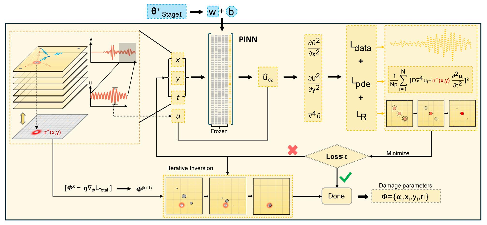
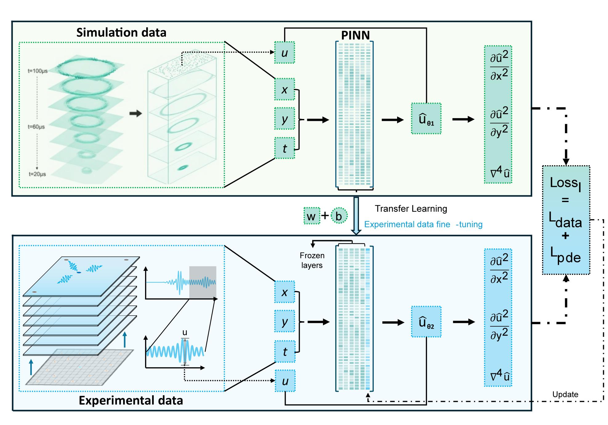
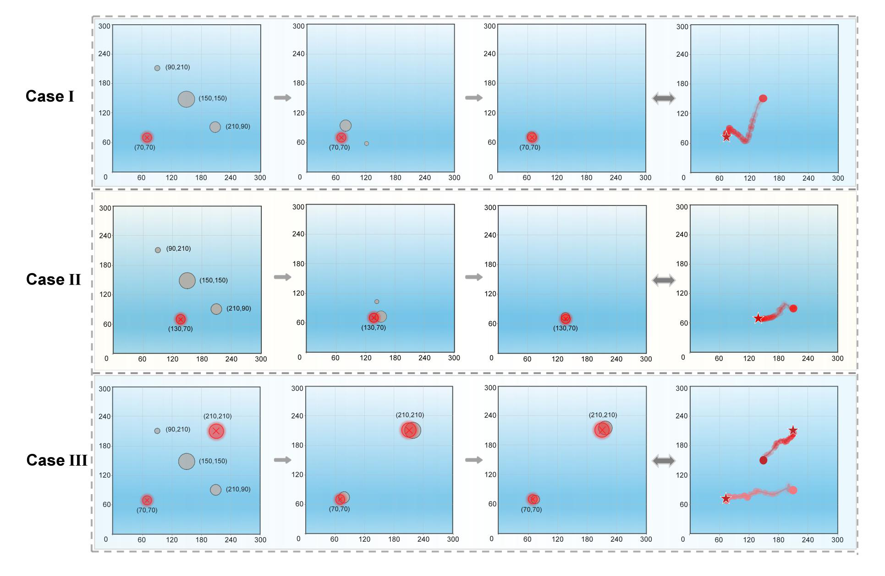
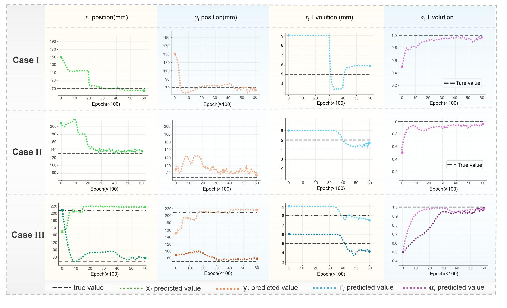

# U-PINN for Thin-Plate Damage Inference

A **paper-informed PyTorch implementation** of two-stage physics-informed damage inference from sparse ultrasonic guided-wave measurements. It combines a Kirchhoff–Love plate model, healthy-wavefield learning, and a small set of learnable damage candidates.

**Status:** the original simulation data, experimental signals, and trained weights are not included. This repository provides an implementation and a synthetic execution check; it does **not** establish reproduction of the manuscript's experimental accuracy.

中文说明：本项目依据 U-PINN 论文完善了物理残差与分阶段反演流程。原始仿真数据、实验数据和论文权重未公开于本仓库；合成示例用于检查程序运行，不能作为论文精度复现。使用方法见 [Quick start](docs/quickstart.md)，论文对照与待确认事项见 [Paper alignment](docs/paper_alignment.md)。

## Run the execution check

From the repository root, using Python 3.10 or later:

~~~bash
python -m pip install -r requirements.txt
python scripts/generate_demo.py --output data/demo
python -m src.main --healthy data/demo/healthy --damaged data/demo/damaged --output results/demo --device cpu --smoke
~~~

The generated “healthy” and “damaged” files contain the **same analytic healthy wavefield**. This deliberately avoids inventing a damaged-plate experiment. A short smoke run checks data loading, derivatives, staged training, and saved outputs; it is too short to assess convergence or candidate rejection. Add <code>--plots</code> to save diagnostic figures.

For measured data and optional simulation-to-experiment transfer:

~~~bash
python -m src.main --pretrain data/simulation --healthy data/healthy --damaged data/damaged --output results/experiment --device auto
~~~

CSV files require columns <code>t,x,y,u</code>. Coordinates must already be normalized using common physical scales; wave amplitudes must use one shared scale across all input folders. See the [data contract](docs/quickstart.md#data-contract) before running. Omitting <code>--pretrain</code> trains directly on healthy observations and skips the simulation-to-experiment transfer step.

## Physical model

Damage is represented as a localized **equivalent areal-density perturbation**, motivated by the manuscript's attached-mass experiments:

$$
\sigma^*(x,y)=\sigma_0+\sum_{i=1}^{K_{\max}}\alpha_i\Delta\sigma_i\,
\operatorname{sigmoid}\!\left[\beta(r_i-d_i(x,y))\right],
\qquad d_i=\sqrt{(x-x_i)^2+(y-y_i)^2}.
$$

The governing equation is

$$
\sigma^*(x,y)w_{tt}
+D(w_{xxxx}+2w_{xxyy}+w_{yyyy})=0,
\qquad D=\frac{Eh^3}{12(1-\nu^2)}.
$$

Locations, radii, and gating variables are optimized through this residual. Spatial and temporal normalization factors are retained in the PDE, including separate plate lengths for rectangular domains. The gate penalty encourages binary activation; it does not guarantee the smallest number of defects.

## Training workflow

*Figure 3 from the supplied manuscript (PDF p. 8): damage-inference architecture and trainable-parameter flow. The phase table below specifies which parameters the implementation updates in each sub-stage.*

Stage-I simulation-to-experiment transfer — paper Figure 2

*Figure 2 from the supplied manuscript (PDF p. 6): healthy simulation pretraining and experimental transfer. This branch is enabled by supplying `--pretrain`.*

| Phase | Trainable wavefield parameters | Trainable damage parameters |
|---|---|---|
| Stage I: healthy simulation pretraining, if supplied | Entire network | None |
| Stage I: healthy experimental transfer, if pretraining was supplied | Last hidden layer and output layer | None |
| Stage II, sub-stage 1 | Last hidden layer and output layer | Gates and centers; radii fixed |
| Stage II, sub-stage 2 | Last hidden layer and output layer | Gates, centers, and radii |
| Stage II, sub-stage 3 | None | Gates, centers, and radii |

The standard architecture has five hidden layers of 50 <code>tanh</code> neurons and uses <code>float64</code>. The smoke configuration is intentionally much smaller. Training settings in <code>src/config.py</code> are explicit engineering defaults where the manuscript does not provide a complete reproducible specification.

## Paper-reported results

The following images are extracted directly from the supplied manuscript at their original pixel dimensions. They are **paper-reported figures**, not predictions or training logs generated by this repository. Figure numbers, PDF pages, and file hashes are recorded in the [figure source map](docs/figure_sources.md).

*Figure 7 (PDF p. 12): three training snapshots and position trajectories for each case. Cases I and II contain one attached-mass damage site; Case III contains two. Open the image to inspect the original-resolution labels.*

*Figure 8 (PDF p. 13): optimization histories for candidate position, nominal radius, and activation gate. Reference curves and epoch axes are retained exactly as supplied in the manuscript.*

## Evidence and limitations

The supplied manuscript reports a mean localization error of **7.52 mm** over four defect locations in three experimental cases, with radius errors of **5.8–18.4%** (PDF pp. 14, 17). These are **paper-reported results**, not measurements from this repository.

The experiments use attached masses on one aluminum plate and a predefined pool of three candidates. They do not establish general crack detection, unbounded defect-count estimation, or performance on other materials. Nominal radius and boundary sharpness are coupled, and several training/data details remain unresolved. See [paper alignment](docs/paper_alignment.md) for the equation map, exact reported cases, and manuscript inconsistencies.

## Repository

~~~text
src/
  config.py         Physical constants and training defaults
  network.py        Fully connected wavefield network
  sampling.py       Collocation sampling
  pinn.py           Physical residual, training, and checkpoints
  main.py           Command-line training pipeline
  plot.py           Diagnostics
scripts/
  generate_demo.py  Analytic healthy-field execution fixture
  extract_paper_figures.py  Regenerate manuscript assets from a local PDF
tests/              Mathematical and workflow regression checks
docs/
  quickstart.md     Data, commands, outputs, and configuration
  method.md         Equations, normalization, and optimization
  paper_alignment.md  Source mapping and reproduction boundaries
  figure_sources.md   Figure/page mapping and extraction provenance
  figures/            Original manuscript workflow images and asset manifest
damage.png          Paper Figure 7: three-case damage evolution
result_1.png        Paper Figure 8: parameter-convergence histories
~~~

Checkpoints and metrics are saved beneath <code>--output</code>; generated data and run artifacts are excluded from version control. The root image filenames are retained for compatibility, but their contents now correspond to manuscript Figures 7 and 8. The previous five-panel illustration and “true damage / simulation / PINN prediction” montage have been replaced; the latter has no matching figure in the supplied manuscript.

Run the regression checks with:

~~~bash
python -m pip install pytest
python -m pytest -q
~~~

The repository's citation metadata is in [CITATION.cff](CITATION.cff); the code license is [LICENSE](LICENSE). The full manuscript is not redistributed here; the selected figure assets are documented separately in [figure sources](docs/figure_sources.md).
